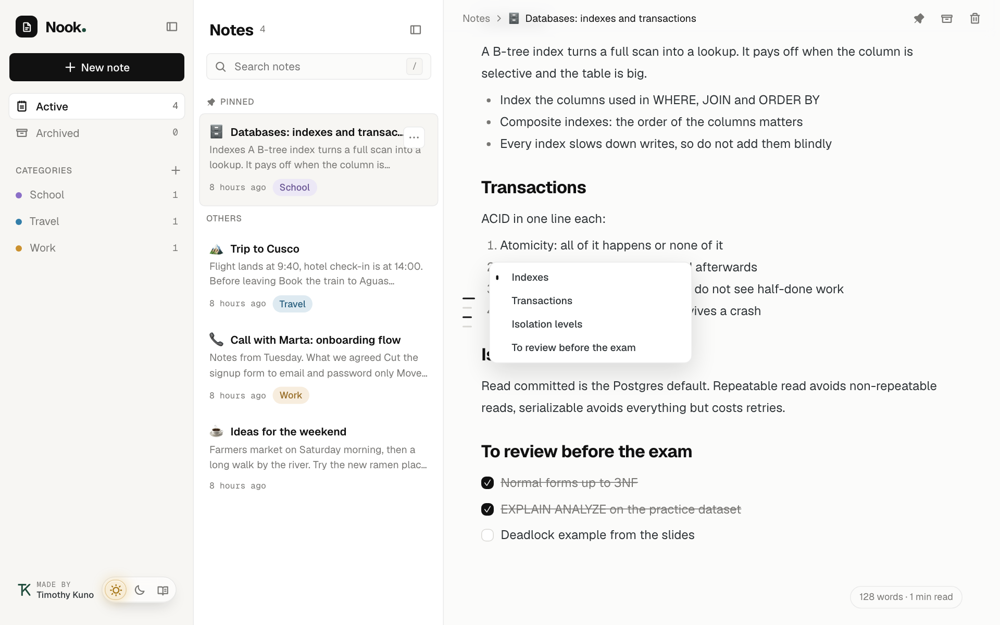
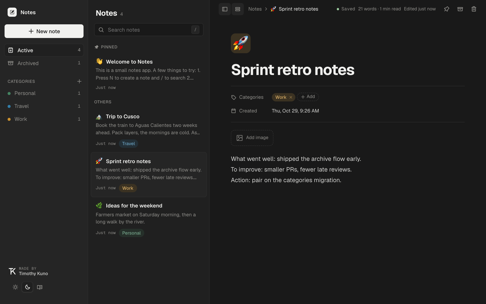
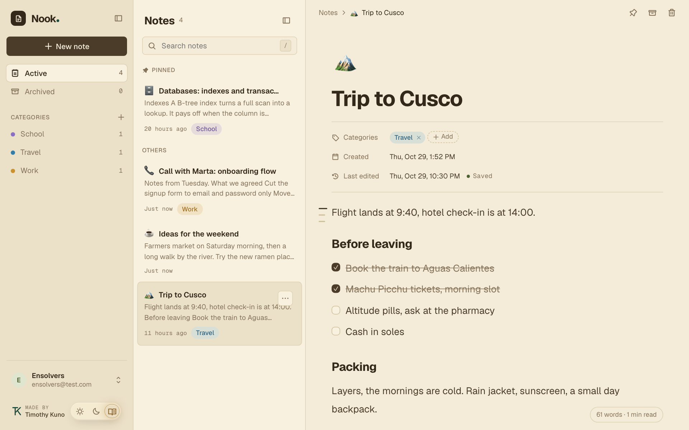
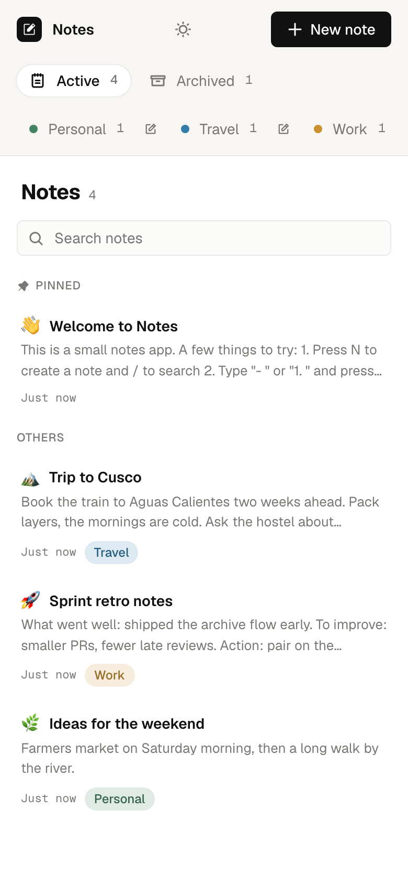
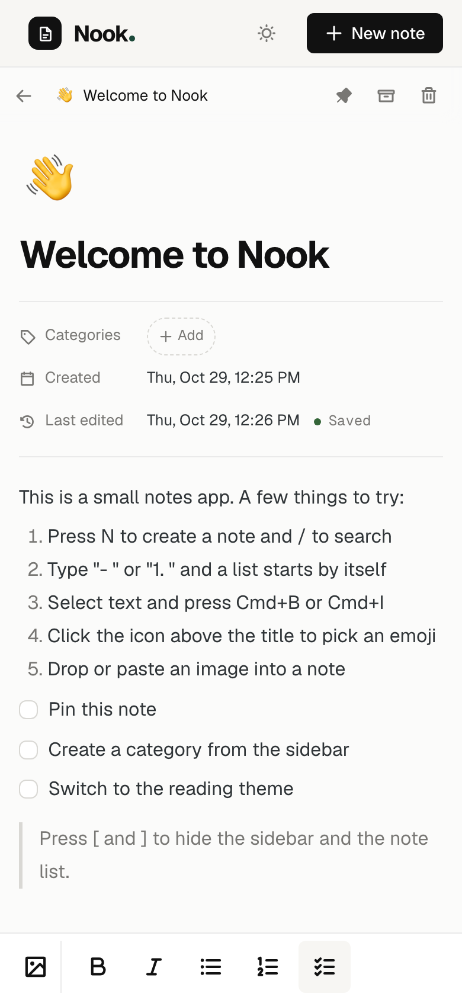

# Nook

A small full stack notes app: write notes, archive them, sort them with colored categories, pin the important ones, add an emoji and images. It was built for a full stack exercise.



- `backend/`: REST API, NestJS + TypeORM + PostgreSQL
- `frontend/`: single page app, React + Vite + TypeScript

## Run it

One command sets up everything and starts the app:

```bash
./run.sh
```

Then open <http://localhost:5173>. The API is at <http://localhost:3000/api>.

The script does this, in order, and stops with a clear message if something is missing:

1. Checks Node, npm and Docker, and that ports 3000, 5173 and 5433 are free.
2. Creates `backend/.env` and `frontend/.env` from the `.env.example` files.
3. Starts PostgreSQL in Docker and waits until it is healthy.
4. Installs the dependencies (`npm ci`) in both apps when they are missing or out of date.
5. Runs the database migrations.
6. Loads a few demo notes, only if the database is empty.
7. Starts the API and the web app.

Press `Ctrl+C` to stop both apps. The database container keeps running; `./run.sh --down` stops it (the data is kept in a Docker volume).

| Option | What it does |
|---|---|
| `--no-seed` | Do not load the demo notes |
| `--lan` | Also open the app to your local network, to try it on a phone (see below) |
| `--down` | Stop the database container and exit |
| `--help` | Show the usage |

Logs are written to `.run/` (ignored by git).

### Try it on your phone

```bash
./run.sh --lan
```

The script prints a second address such as `http://192.168.1.20:5173`. Open it on a phone connected to the same Wi-Fi. The first time, macOS may ask whether Node can accept incoming connections: allow it. On the computer, open the printed address too (not `localhost`), so the browser and the API agree on the origin.

The API accepts several browser origins: `FRONTEND_URL` can hold a comma separated list.

### Without the script

```bash
docker compose up -d db
cp backend/.env.example backend/.env
cp frontend/.env.example frontend/.env
npm --prefix backend ci && npm --prefix frontend ci
npm --prefix backend run migration:run
npm --prefix backend run seed
npm --prefix backend run start:dev
npm --prefix frontend run dev
```

The last two commands run in separate terminals.

## Requirements

| Tool | Version used | Notes |
|---|---|---|
| Node.js | 22.23.2 | Minimum 22 (see `.nvmrc`) |
| npm | 10.9.8 | Comes with Node |
| Docker | 29.1.3 | Runs the database |
| Docker Compose | 2.40.3 | `docker compose` (v2) |
| PostgreSQL | 16.4 | Runs in Docker (`postgres:16.4-alpine`), nothing to install |
| Bash | 3.2 or newer | For `run.sh` |

Developed and tested on macOS (Apple silicon). `run.sh` only uses portable bash and standard tools, so it should work on Linux too, but it was not tested there.

### Main libraries

| Backend | Version | Frontend | Version |
|---|---|---|---|
| NestJS | 11.2.8 | React | 19.3.1 |
| TypeORM | 1.1.2 | Vite | 8.3.5 |
| `pg` | 8.23.1 | TypeScript | 7.0.2 |
| class-validator | 0.15.1 | Motion | 14.7.1 |
| class-transformer | 0.5.1 | Phosphor Icons | 2.1.10 |
| TypeScript | 5.9.3 | oxlint | 1.90.0 |
| Jest | 30.5.2 | TipTap | 3.32.1 |

## Features

**Phase 1**

- Create, edit and delete notes. Changes are saved automatically while you type.
- Archive and unarchive notes, with an Undo.
- List active notes and archived notes.

**Phase 2**

- Add and remove categories on a note.
- Filter the list by category.

**Extras**

- Categories with their own color (a 10 color palette or any custom color), created and edited from the sidebar.
- Pin notes to the top of the list.
- Emoji icon for each note, with a searchable picker.
- Images inside the text of a note (JPEG, PNG, GIF, WebP, up to 5 MB each and 30 per note): paste, drag and drop onto the text, or use the insert button, and click one to see it full screen.
- Search, a live word count and reading time.
- An outline rail: when a note has three or more headings, a column of thin dashes sits in the left margin, outside the text, and shows its structure. It highlights the heading you are reading, opens a list of titles on hover, and jumps to a heading when you click it. It is hidden on narrow screens.
- A slash menu: type `/` in a note to insert a heading, list, checklist, quote, code block, divider or image, filtering as you type.
- A rich text editor with Markdown shortcuts: `1. ` and `- ` start a list, `[ ] ` a checklist, `# ` a heading, `> ` a quote, and `**bold**` or `_italic_` format as you type. Cmd/Ctrl+B and Cmd/Ctrl+I work, Tab indents list items. Notes are stored as Markdown text.
- Light, night and reading themes (the reading theme uses warm paper tones with no white).
- Hide the sidebar and the note list.
- Mobile layout with a formatting bar above the keyboard.

| Night | Reading |
|---|---|
|  |  |

| Mobile list | Mobile editor |
|---|---|
|  |  |

## Keyboard shortcuts

| Key | Action |
|---|---|
| `N` | New note |
| `/` | Search notes (outside the text of a note) |
| `/` inside a note | Open the block menu |
| `[` | Hide or show the sidebar |
| `]` | Hide or show the note list |
| `\` | Hide or show both |
| `Enter` on an empty list item | Leave the list |
| `Tab` / `Shift+Tab` | Indent or outdent list items |
| `Cmd/Ctrl+B`, `Cmd/Ctrl+I` | Bold and italic |
| `Cmd/Ctrl+Z`, `Cmd/Ctrl+Shift+Z` | Undo and redo |

Single key shortcuts are ignored while you type in a field.

## Architecture

The API follows the layered structure the exercise asks for. Each layer only talks to the next one:

```
HTTP request
   ↓
Controller      routes, ids and DTO validation (ValidationPipe)
   ↓
Service         business rules, throws HTTP exceptions
   ↓
Repository      the only code that touches TypeORM
   ↓
PostgreSQL
```

```
backend/src
├── notes/         controller, service, repository, entity, dto
├── categories/    controller, service, repository, entity, dto
├── images/        controller, service, repository, entity, image type detection
├── common/        global error filter
├── config/        environment configuration
└── database/      data source, migrations, seed

frontend/src
├── workspace/     the three pane layout and the editor
├── notes/         types, API client, list hook
├── categories/    chips, picker, sidebar list, form
├── emoji/         emoji data and picker
├── components/    dialog and toast
└── lib/           http client, autosave, themes, panels, markdown helpers
```

### Decisions worth knowing

- **Migrations, not `synchronize`.** The schema only changes through the migrations in `backend/src/database/migrations`. `run.sh` applies them.
- **Validation.** Every request body goes through DTOs with `class-validator`, with `whitelist` and `forbidNonWhitelisted` on. Errors always look like `{ statusCode, message, path, timestamp }`.
- **Images live in PostgreSQL** (`bytea`), so everything persists in the database and `run.sh` needs no extra storage. The type is detected from the file content, not from what the browser says. In the note text an image is plain Markdown, ``, and the editor resolves that path against the API address. Images that are no longer in the text are removed when you leave the note.
- **Pinning is not an edit.** Pinning a note keeps its `updatedAt`, and archiving a pinned note unpins it.
- **Category filter.** The API supports `GET /api/notes?categoryId=...`, which keeps all the categories of each note. The UI filters the notes it already has in memory, so it is instant and it works with Undo. Switching the UI to the server filter is a small change.
- **Category colors** are stored as `#rrggbb`. The chips derive their background and text from that color and the current theme, so any color works in every theme.
- **Notes are Markdown.** The `content` column holds plain Markdown text and the editor (TipTap) shows it formatted, so notes stay readable and portable, and old plain text notes are valid Markdown. Markdown has no underline, so there is none.
- **Autosave** waits 600 ms after you stop typing, and flushes a pending save when you leave the note.

## API

All routes are under `/api`. Ids are UUIDs.

| Method | Route | Description |
|---|---|---|
| `GET` | `/notes?archived=false&categoryId=` | List notes (pinned first, then latest) |
| `GET` | `/notes/:id` | Get a note |
| `POST` | `/notes` | Create a note (`title`, optional `content`, `emoji`) |
| `PATCH` | `/notes/:id` | Update `title`, `content` or `emoji` (`null` clears it) |
| `DELETE` | `/notes/:id` | Delete a note |
| `PATCH` | `/notes/:id/archive` | Archive (also unpins) |
| `PATCH` | `/notes/:id/unarchive` | Unarchive |
| `PATCH` | `/notes/:id/pin` | Pin (not allowed on archived notes) |
| `PATCH` | `/notes/:id/unpin` | Unpin |
| `PUT` | `/notes/:id/categories/:categoryId` | Add a category to a note |
| `DELETE` | `/notes/:id/categories/:categoryId` | Remove a category from a note |
| `GET` | `/categories` | List categories |
| `POST` | `/categories` | Create (`name`, optional hex `color`) |
| `PATCH` | `/categories/:id` | Rename or recolor |
| `DELETE` | `/categories/:id` | Delete (removed from every note) |
| `POST` | `/notes/:noteId/images` | Upload an image (`multipart/form-data`, field `file`) |
| `GET` | `/notes/:noteId/images/:imageId` | Get the image bytes |
| `DELETE` | `/notes/:noteId/images/:imageId` | Delete an image |

## Data model

| Table | Columns |
|---|---|
| `notes` | `id`, `title` (max 120), `content`, `emoji`, `archived`, `pinned`, `createdAt`, `updatedAt` |
| `categories` | `id`, `name` (unique, case insensitive), `color` (`#rrggbb`), `createdAt` |
| `note_categories` | `noteId`, `categoryId` (many to many, deleted in cascade) |
| `note_images` | `id`, `noteId` (cascade), `filename`, `mimeType`, `size`, `data`, `createdAt` |

## Tests and checks

```bash
npm --prefix backend test           # 60 unit tests (services, DTOs, image detection)
npm --prefix backend run build
npm --prefix backend run lint       # ESLint (applies safe fixes)
npm --prefix frontend run build     # type check and bundle
npm --prefix frontend run lint
```

The frontend has no automated UI tests. It was checked by hand and with browser automation on desktop and on a phone sized screen.

## Troubleshooting

- **Port 5433 is in use.** The database listens on 5433 because a local PostgreSQL often uses 5432. Stop the program using it, or pick another port on a fresh checkout: `DB_PORT=5434 ./run.sh`. If `backend/.env` already exists, change `DB_PORT` there as well.
- **Docker is not running.** On macOS the script tries to open Docker Desktop. On Linux start the daemon first.
- **Node is too old.** Use Node 22 or newer. With nvm: `nvm install && nvm use`.
- **Start over with an empty database.** `docker compose down -v` removes the container and its data; then run `./run.sh` again.

## Login and deployment

The app has no login screen, and it is not deployed.

## Credits

Made by Timothy Kuno.
